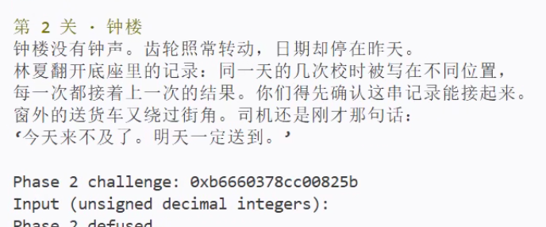
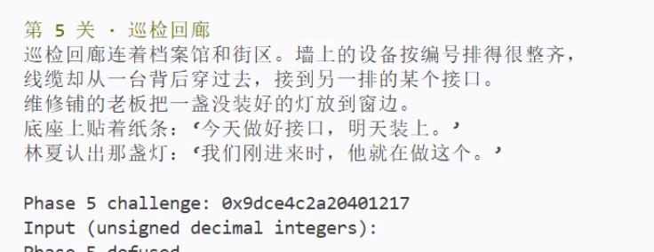

# BombLab 实验报告

## 1. 实验环境与分析方法

实验在 WSL 的 Linux x86-64 环境中完成，使用 GCC 15.2.0、GNU objdump 2.46 和 Python 3.14.4。正式六关与 Honor 均已实现，求解代码位于 `defuser.c`。个人炸弹保留原始内容。

分析采用静态反汇编与程序运行验证：先检查各关的输入解析和最终比较，再沿调用关系恢复运算。本文汇编片段使用 Intel 语法，即目的操作数在前；地址均来自本仓库的个人炸弹。导出方式为：

```sh
objdump -d -M intel --no-show-raw-insn --disassemble=phase_01 ./bomb
objdump -d -M intel --no-show-raw-insn --disassemble=p1_compute ./bomb
```

后续关卡按同样方式检查入口及其调用的辅助函数。对跳转表、节点表和函数指针表，结合 `objdump -s` 读取静态数据。验证时使用原始炸弹检查求解器输出。

以下记 `c = challenge`，`U32(x)` 表示只保留低 32 位，`^` 表示按位异或。除对 `c`、`context` 的移位外，公式中的加、减、乘和左移均按 32 位无符号数解释，结果模 $2^{32}$。这一点对应汇编中写入 `eax`、`edi` 等 32 位寄存器的行为。

各关输入字段数可由调用 `valid_u32_fields` 前的参数，以及 `sscanf` 后对返回值的比较共同确认：

| 关卡 | 正式口令格式 | 核心计算 |
| --- | --- | --- |
| 1 | 1 个无符号整数 | 三个辅助函数的参数与返回值组合 |
| 2 | 6 个无符号整数 | 数组递推 |
| 3 | 2 个无符号整数 | 分支编号与跳转表选出的结果 |
| 4 | 1 个无符号整数 | 二分递归路径的返回值 |
| 5 | 2 个无符号整数 | 链表累计值与最后一个节点的标识 |
| 6 | 1 个无符号整数 | 两次间接调用的结果 |
| Honor | 前缀及 3 个无符号整数 | 局部对象布局与上下文相关校验 |

## 2. 第 1 关：函数调用与参数传递

`phase_01` 在解析一个整数后调用 `p1_compute`，并将返回的 `eax` 与输入比较。因而需要恢复 `p1_compute` 的整体返回值。

入口中的右移分别提取高 32 位和从第 16 位开始的片段。记：

```text
L = U32(c)
H = U32(c >> 32)
M = U32(c >> 16)
```

`M` 有 32 位，不能误写为仅取中间的 16 位。关键调用序列如下：

```asm
40206e: call p1_step0
402073: mov  rsi,rdx
402076: mov  edi,r9d
402079: mov  ecx,eax
40207b: call p1_step1
402080: mov  esi,r8d
402083: mov  edi,eax
402085: call p1_step2
40208b: xor  eax,ecx
```

结合每个 `call` 前寄存器的含义，三次调用依次为 `step0(L,H)`、`step1(H,M)`、`step2(step1的结果,L)`。三个辅助函数的核心指令为：

```asm
; p1_step0
xor esi,0x8c80
lea eax,[rsi+rdi*2]

; p1_step1
lea eax,[rdi+rdi*4]
add esi,0xe36d
xor eax,esi

; p1_step2
sub edi,esi
lea eax,[rdi+rdi*2+0x4382]
```

因此口令为：

```text
A = 2*L + (H ^ 0x8c80)
B = (5*H) ^ (M + 0xe36d)
answer = (3*(B - L) + 0x4382) ^ A
```

这里的 `lea` 实现乘法与加法，并不读取内存。`ecx` 保存第一次调用的结果；检查后面两个辅助函数可确认它们没有覆盖 `ecx`，因此最后的异或确实使用 `A`。不能仅凭“调用者保存寄存器”的分类，推断每次调用一定会改写它。

非公开 seed `987654322` 的第 1 关运行截图：


## 3. 第 2 关：数组与递推

本关读取六个整数。第一个元素的检查对应：

```asm
402160: shr rax,0xc
402164: not eax
402166: and eax,0xf
402169: cmp esi,eax
```

因此：

```text
a[0] = (~U32(c >> 12)) & 15
```

后面的循环以 `rdx = i` 为下标，从 1 迭代到 5：

```asm
402172: lea ecx,[rdx+0x11]
402175: mov rax,r13
402178: shr rax,cl
40217b: lea ecx,[rsi+rsi*2]
40217e: mov esi,DWORD PTR [rbp+rdx*4-0x40]
402182: and eax,0x1f
402185: sub ecx,edx
402187: add eax,0x1
40218a: xor eax,ecx
40218c: cmp esi,eax
```

执行 `lea ecx,[rsi+rsi*2]` 时，`esi` 仍然保存上一项；紧接着的 `mov` 才读取当前输入项。由这个更新顺序可以恢复：

```text
t[i] = ((c >> (i + 17)) & 31) + 1
a[i] = (3*a[i-1] - i) ^ t[i],  i = 1,...,5
```

`rdx*4` 对应每个数组元素占 4 字节。实现使用 `uint32_t values[6]`，按顺序生成六项。即使减法发生下溢，也按无符号数回绕，与原程序一致。

非公开 seed `987654322` 的第 2 关运行截图（原图下缘裁切，成功提示未完整显示）：



## 4. 第 3 关：switch 与跳转表

`phase_03` 要求第一个数等于 `c & 7`，并用下式生成辅助函数的输入：

```text
s = c & 7
x = U32(c >> 3) ^ U32(c >> 32)
```

`p3_dispatch` 的关键指令为：

```asm
402244: mov eax,edi
402246: mov edi,esi
402248: cmp eax,0x7
40224b: ja  402295
40224d: notrack jmp QWORD PTR [rax*8+0x405820]
```

表中每个入口为 8 字节地址，指向一个再跳往具体辅助函数的分支。读取 `0x405820` 开始的八个表项并追踪目标后，得到如下对应关系；函数名后缀不等于输入分支编号。

| `s` | 跳转目标 | 最终辅助函数 | 返回值 `f_s(x)` |
| --- | --- | --- | --- |
| 0 | `0x402268` | `p3_case_1` | `5*x + 0x8bc9` |
| 1 | `0x402270` | `p3_case_7` | `(x ^ 0x1ef9) + (x >> 1)` |
| 2 | `0x402278` | `p3_case_6` | `5*x + 0xaee6` |
| 3 | `0x402280` | `p3_case_3` | `5*x + 0xf4d5` |
| 4 | `0x402288` | `p3_case_2` | `(2*x) ^ 0x3651` |
| 5 | `0x402290` | `p3_case_4` | `(4*x) ^ 0x1154` |
| 6 | `0x402258` | `p3_case_0` | `(x ^ 0xea48) + (x >> 2)` |
| 7 | `0x402260` | `p3_case_5` | `5*x + 0x1b5f3` |

口令为 `s f_s(x)`。实现直接按上表写成 `switch`，其中所有右移都作用于无符号数，因此是逻辑右移。

非公开 seed `987654322` 的第 3 关运行截图：


## 5. 第 4 关：递归调用与返回过程

入口恢复出的参数为：

```text
target = c & 127
salt = U32(c >> 7) ^ U32(c >> 32)
answer = F(target, 0, 127, salt)
```

`p4_walk` 首先计算中点：

```asm
402324: mov eax,edi
402326: mov edi,edx
402328: sub edi,esi
40232a: shr edi,1
40232c: add edi,esi
40232e: cmp edi,eax
402330: je  402380
```

此时 `eax` 是目标值，`esi`、`edx` 分别是区间下界和上界。故中点为 `m = low + ((high-low) >> 1)`。命中时执行：

```asm
402380: lea eax,[rdi+0x82]
402386: xor eax,ecx
```

未命中时，通过无符号比较 `jb` 决定进入左半区还是右半区。返回阶段的 `lea eax,[rax+rax*4]` 将子结果乘 5，再与当前层保存的 `m + salt` 异或；左右分支最后分别再异或 4 和 7。因此：

```text
F(t,l,h,s):
    m = l + ((h-l) >> 1)
    if t == m: return (m + 0x82) ^ s
    if t <  m: return (5*F(t,l,m-1,s)) ^ (m+s) ^ 4
    otherwise: return (5*F(t,m+1,h,s)) ^ (m+s) ^ 7
```

需要保留的是每一层返回时的组合顺序，而不只是查找目标的过程。`target` 被限制在 `[0,127]`，递归调用始终保留含有目标的子区间，最多经过 8 层，能够终止，也不会在有效路径上产生无效区间。

验证用的非公开 seed 对应 `target = 52`，中点序列为 `63 → 31 → 47 → 55 → 51 → 53 → 52`，覆盖了左右两种递归分支。

非公开 seed `987654322` 的第 4 关运行截图：


## 6. 第 5 关：结构体与链表遍历

`p5_traverse` 从头指针表中选择起点。下列访问说明每个节点包含一个 8 字节指针以及两个 4 字节字段：

```asm
402424: mov rdx,QWORD PTR [rax*8+0x405b60]
402439: mov esi,DWORD PTR [rdx+0x8]
402443: add eax,DWORD PTR [rdx+0xc]
402446: lea eax,[rax+rax*4]
402449: mov DWORD PTR [r8],esi
40244c: xor eax,esi
...
402458: mov rdx,QWORD PTR [rdx]
```

对应布局为：

```c
struct node {
    struct node *next;  /* +0 */
    uint32_t tag;       /* +8 */
    uint32_t value;     /* +12 */
};                     /* 16 bytes */
```

节点表始于 `0x405ba0`。以该地址为编号 0、每 16 字节递增一个编号，可以把原始指针恢复为节点编号：

| 节点编号 | next 编号 | tag | value |
| --- | --- | --- | --- |
| 0 | 1 | `0x072f` | `0x6fc4` |
| 1 | NULL | `0x090d` | `0x707c` |
| 2 | 4 | `0x0032` | `0x4a85` |
| 3 | 10 | `0x0132` | `0xbd6e` |
| 4 | 7 | `0x024b` | `0xf43d` |
| 5 | 8 | `0x0414` | `0x848e` |
| 6 | 11 | `0x0553` | `0x48ac` |
| 7 | 5 | `0x0a11` | `0x68e9` |
| 8 | 6 | `0x033c` | `0x61e3` |
| 9 | 0 | `0x0629` | `0x2332` |
| 10 | 9 | `0x0b2c` | `0xbba1` |
| 11 | 3 | `0x083b` | `0x5384` |

头指针表的顺序为 `{2,4,7,5,8,6,11,3}`。状态初始化及更新规则为：

```text
head_index = c & 7
links = (c >> 3) & 3
acc = U32(c >> 6) ^ U32(c >> 32) ^ 0xe145

从 heads[head_index] 开始，每访问一个节点：
    acc = (5*(acc + node.value)) ^ node.tag
    last_tag = node.tag
```

头节点先处理一次，随后再沿 `next` 前进 `links` 次，所以实际处理 `links + 1` 个节点，即 1 至 4 个。若把 `links` 误当成处理的节点总数，会少处理头节点。

最终口令为 `acc last_tag`。实现中的节点编号只用于表达原始链接关系，不依赖炸弹的运行地址。非公开 seed 的起点为编号 3，经过 `3 → 10 → 9`，最后的 `tag = 0x0629 = 1577`，与输出第二项一致。

非公开 seed `987654322` 的第 5 关运行截图（原图下缘裁切，成功提示未完整显示）：



## 7. 第 6 关：函数指针表与间接调用

`p6_dispatch` 先从 `challenge` 得到工作值，再进行两次间接调用：

```asm
402590: and  ebx,0x38
402593: and  eax,0x7
402596: call QWORD PTR [rax*8+0x405e00]
40259d: xor  eax,0xd56
4025a2: mov  edi,eax
4025a4: call QWORD PTR [rbx+0x405e00]
4025af: add  eax,0x57a
```

第一次调用的索引为 `i = c & 7`。第二次调用使用的 `rbx` 已经是字节偏移 `c & 0x38`，除以指针大小 8 后，实际索引为 `j = (c >> 3) & 7`。

表 `0x405e00` 中八个入口依次为：

```text
T = {op1, op2, op3, op5, op4, op3, op0, op4}
```

六个运算函数为：

| 函数 | 返回值 |
| --- | --- |
| `op0(x)` | `(x + 0xef61) ^ (x >> 5)` |
| `op1(x)` | `ROL32(x,5) ^ 0x5653` |
| `op2(x)` | `((x << 5) + 0xe64c) ^ (7*x)` |
| `op3(x)` | `ROR32(x,3)` |
| `op4(x)` | `((x >> 3) ^ x) + 0x22f2` |
| `op5(x)` | `(x ^ 0xbbd8) + 8*x` |

`ROL32`、`ROR32` 分别表示 32 位循环左移和右移。普通移位会丢弃移出的位，不能直接替代 `rol`、`ror`；例如 `ROR32(x,3) = (x >> 3) | (x << 29)`。

整体计算为：

```text
x = U32(c >> 6) ^ U32(c >> 32)
y = T[c & 7](x) ^ 0x0d56
answer = T[(c >> 3) & 7](y) + 0x057a
```

非公开 seed 对应 `i = 3`、`j = 2`，因此本次执行的顺序为 `op5` 后接 `op3`。实现保留八项函数指针表，重复表项也保留，避免将八个索引误当成六种不同函数。

非公开 seed `987654322` 的第 6 关运行截图：


## 8. Honor：局部对象布局与上下文校验

### 8.1 第七行的入口格式

`secret_gate` 的复制目标基址是 `rbp-0xd0`。复制后的标记检查和文本解析入口分别为：

```asm
40272b: lea  r12,[rbp-0xd0]
...
402751: sub  rax,0x24
402755: cmp  rax,0x7f
402759: jbe  402770
...
402776: call secret_copy
40277b: cmp  DWORD PTR [rbp-0xb0],0x4e45504f
...
40278d: lea  rdi,[rbp-0xac]
402794: call secret_phase
```

`strlen` 的结果减 36 后进行无符号比较，要求文本长度位于 `[36,163]`。两个地址相对复制基址的偏移为：

```text
(rbp-0xb0) - (rbp-0xd0) = 32
(rbp-0xac) - (rbp-0xd0) = 36
```

所以第七行前 32 字节可作为填充，第 32 至 35 字节必须组成标记，第 36 字节起是传给 `secret_phase` 的字符串。小端序下，`0x4e45504f` 的字节顺序是 `4f 50 45 4e`，即 ASCII 字符串 `OPEN`。

构造格式如下：

```text
[32 个 A][OPEN][第一个整数 空格 第二个整数 空格 第三个整数]
```

这一输入利用的是局部对象内各字段的位置关系，未涉及返回地址。生成的文本长度在 41 至 59 字节之间，满足入口长度约束。

### 8.2 三个整数的计算

`secret_phase` 解析三个无符号整数。令 `k = context`，并定义：

```text
s = U32(k) & 3
C = U32(c) ^ U32(c >> 32)
K = U32(k) ^ U32(k >> 32)
```

第一个数与 `s` 比较。第二个数涉及的关键指令为：

```asm
4026a0: imul r9d,ecx,0x8bff
...
4026b8: shr  r13,0x10
4026be: xor  r9d,r13d
4026c1: xor  edi,r8d
4026c4: call secret_mix
4026c9: xor  eax,r9d
```

`secret_mix` 对输入做循环右移 7 位，再异或 `0xaa1c`。第三个数的检查又使用 `C >> 7` 和 `K+s+0x21e3`。恢复出的三个值为：

```text
v0 = s
v1 = ROR32(C ^ K,7) ^ 0xaa1c ^ (s*0x8bff) ^ U32(k >> 16)
v2 = v1 ^ (K + s + 0x21e3 + (C >> 7))
```

注意 `U32(k >> 16)` 保留的是移位后的 32 位，不能截成 16 位。`context` 由驱动根据前六行口令计算，因此 Honor 必须与同一个 seed 的前六关一起验证。

非公开 seed `987654322` 的 Honor 运行截图，末尾显示 `Secret phase defused.`：


## 9. 验证记录

### 9.1 编译与公开测试

在仓库根目录执行：

```sh
make
python3 public_test.py
```

实际编译参数为 `-std=c11 -O2 -Wall -Wextra -Wpedantic -Werror`，编译成功。公开测试结果为：

```text
Public tests: 60/60
Secret public tests: 10/10
```

下图为 `python3 public_test.py` 的终端运行截图，包含六关与 Honor 的测试汇总。


### 9.2 公开列表之外的 seed

选用 `seed = 987654322`。该值不在 `tests/public.json` 的十个公开 seed 中。以下表格记录同一次完整运行的 challenge 和求解器输出：

| 关卡 | challenge（十六进制） | 口令 |
| --- | --- | --- |
| 1 | `0x3fb7ed56d3813a38` | `3859089372` |
| 2 | `0xb6660378cc00825b` | `7 21 60 176 525 1587` |
| 3 | `0x12f80d8f069fb3d4` | `4 3830956475` |
| 4 | `0x8216c925433a00b4` | `1814027559` |
| 5 | `0x9dce4c2a20401217` | `139934483 1577` |
| 6 | `0xf6f51d55c8f52d93` | `3054608122` |
| Honor | `0x4a7bfaac9b9bd281` | 32 个 `A` 后接 `OPEN0 1296382420 1098080262` |

该次 Honor 的 `context = 0x7de528f377775f6c`。复现命令为：

```sh
{ ./defuser --seed 987654322; ./defuser --secret --seed 987654322; } \
    | ./bomb --seed 987654322
```

实际复现输出包含 `Phase 1 defused.` 至 `Phase 6 defused.`，以及 `Secret phase defused.`，进程退出状态为 0。七关截图分别列于第 2 至第 8 节。第 2、5 关的截图保留原始裁切范围，底部成功提示未完整显示；这两关的通过结果同时由实际复现记录和公开测试校验。

### 9.3 分支与缓冲区边界

补充检查没有只依赖 seed 生成的数据：对六关分别传入 318 个直接 challenge，共进行 1,908 次原始炸弹校验，均通过。样本包含低七位的全部组合、64 位单比特值及其反码、全零和全一等边界，以及固定随机序列。由低位枚举覆盖了第 3 关的八个分支、第 4 关的 128 个目标、第 5 关的全部 32 种起点与长度组合，以及第 6 关的全部 64 种调用索引组合。

此外，64 个公开列表之外的 seed 均通过六关和 Honor 的联合运行，Honor 的 `context & 3` 覆盖 0、1、2、3 四种情况。

对输出接口，另以 ASan 和 UBSan 检查空指针、零容量、容量不足、恰好容纳字符串及结尾空字符等情况，共 88,062 次检查通过。缓冲区前后放置的保护字节未被改写。`snprintf` 返回值表示原本需要写出的字符数，所以只有返回值非负且严格小于剩余容量时，才能判定本次写入成功。

这些测试覆盖了已识别的控制分支和部分数值边界，不能等同于枚举全部 $2^{64}$ 个输入；解法对其他输入的依据仍是各条运算与原始指令语义的一致性。

## 10. 实现说明与资料

全部求解函数只根据输入参数计算结果，并向调用者提供的缓冲区写入文本。正式六关使用无符号十进制格式，Honor 使用固定前缀和三个整数；输出不附带换行，由公共驱动统一输出。递归只出现在第 4 关且深度有界，其余关卡的循环次数和表规模均固定。

本文使用的直接依据与仓库资料如下：

1. [课程实验说明与提交要求](README.md)：接口、测试方式及报告要求。
2. [本人的二进制炸弹](bomb)：各关指令、跳转表、节点内容及函数指针表的直接依据。
3. [tutor 教学说明](tutor/README.md)：入口参数、输入解析和辅助函数返回值的分析方法。
4. [教学示例说明](teaching/README.md)：数组、递归、链表和间接调用等结构的对照材料；正式解法中的常量以个人炸弹为准。
5. [公共驱动](defuser_main.c)与[challenge/context 实现](challenge.c)：确认求解接口、seed 到 challenge 的变换，以及 Honor 的上下文来源。

复现所需工具为 GCC、GNU Make、binutils 中的 objdump 和 Python。
