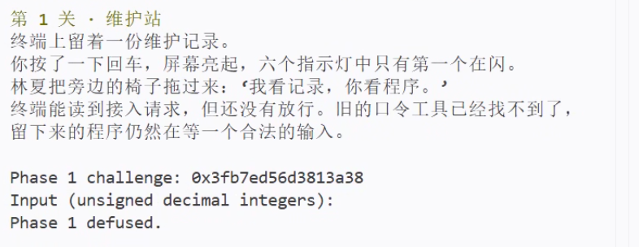
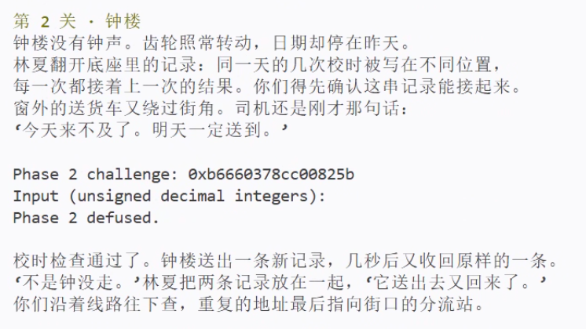
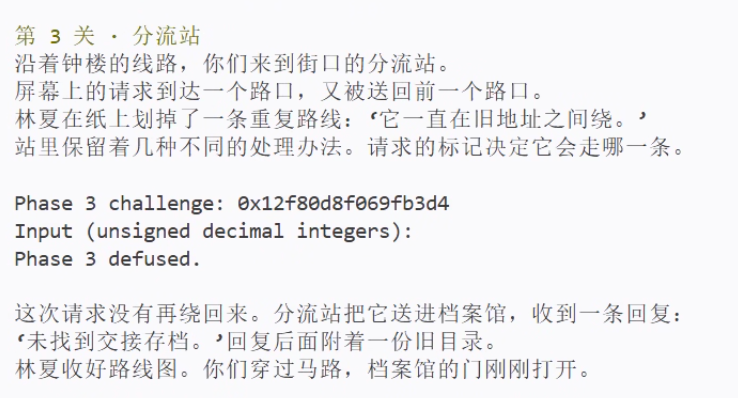
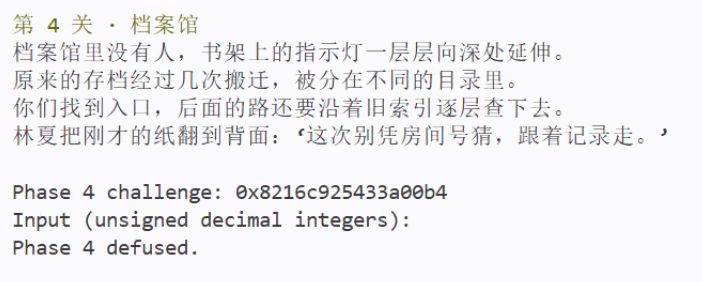
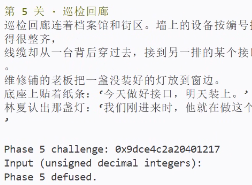
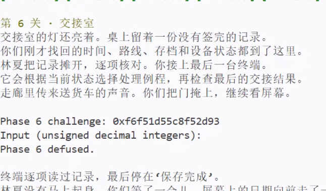
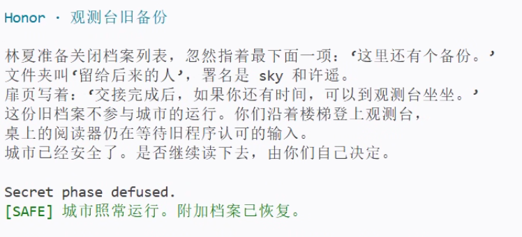
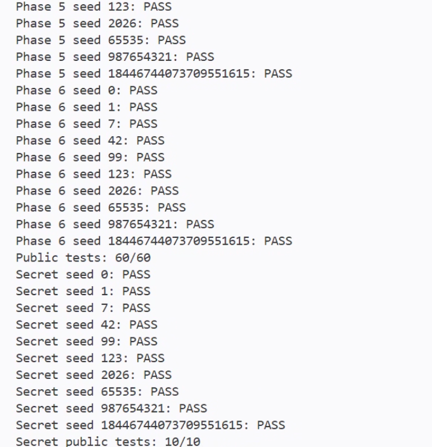

# BombLab 实验报告

## 1. 实验环境与分析方法

运行环境是 WSL 下的 Linux x86-64，编译器为 GCC 15.2.0，另使用 GNU objdump 2.46 和 Python 3.14.4。六个正式关卡和 Honor 的解法都写在 `defuser.c` 中，个人炸弹未作修改。

分析时先从输入解析确定口令有几个数，再看最终比较的是哪个结果，随后追踪计算这个结果的函数。汇编用 objdump 导出，恢复出的公式交给原始炸弹验证。下文统一使用 Intel 语法，目的操作数在前；指令地址取自本仓库的个人炸弹。例如，第 1 关的入口和辅助函数可以这样查看：

```sh
objdump -d -M intel --no-show-raw-insn --disassemble=phase_01 ./bomb
objdump -d -M intel --no-show-raw-insn --disassemble=p1_compute ./bomb
```

其余关卡也分别查看入口和被调用的函数。跳转表、节点表与函数指针表还需要用 `objdump -s` 读取表项，单看函数指令不足以确定它们的顺序。

下面记 `c = challenge`，`U32(x)` 表示取低 32 位，`^` 表示按位异或。对 `c`、`context` 的移位保留 64 位语义，其余加、减、乘和左移按 32 位无符号运算处理，结果模 $2^{32}$。代码使用 `uint32_t` 保留这种回绕行为。

各关在调用 `valid_u32_fields` 时传入字段数，随后还检查 `sscanf` 的返回值，两处信息一致：

| 关卡 | 正式口令格式 | 核心计算 |
| --- | --- | --- |
| 1 | 1 个无符号整数 | 三个辅助函数的参数与返回值组合 |
| 2 | 6 个无符号整数 | 数组递推 |
| 3 | 2 个无符号整数 | 分支编号与跳转表选出的结果 |
| 4 | 1 个无符号整数 | 二分递归路径的返回值 |
| 5 | 2 个无符号整数 | 链表累计值与最后一个节点的标识 |
| 6 | 1 个无符号整数 | 两次间接调用的结果 |
| Honor | 前缀及 3 个无符号整数 | 局部对象布局与上下文相关校验 |

## 2. 第 1 关：函数调用与参数传递

第 1 关只读一个整数。`phase_01` 调用 `p1_compute` 后，将 `eax` 与输入比较，所以口令就是这个函数的返回值。

`p1_compute` 先拆出 challenge 的几个片段：

```text
L = U32(c)
H = U32(c >> 32)
M = U32(c >> 16)
```

其中 `M` 是右移 16 位后的低 32 位，覆盖原数的第 16 至 47 位。接下来的调用顺序是：

```asm
40206e: call p1_step0
402073: mov  rsi,rdx
402076: mov  edi,r9d
402079: mov  ecx,eax
40207b: call p1_step1
402080: mov  esi,r8d
402083: mov  edi,eax
402085: call p1_step2
40208b: xor  eax,ecx
```

逐次检查 `call` 前的参数寄存器，可得三次调用分别是 `step0(L,H)`、`step1(H,M)` 和 `step2(step1的结果,L)`。辅助函数本身都很短：

```asm
; p1_step0
xor esi,0x8c80
lea eax,[rsi+rdi*2]

; p1_step1
lea eax,[rdi+rdi*4]
add esi,0xe36d
xor eax,esi

; p1_step2
sub edi,esi
lea eax,[rdi+rdi*2+0x4382]
```

因此口令为：

```text
A = 2*L + (H ^ 0x8c80)
B = (5*H) ^ (M + 0xe36d)
answer = (3*(B - L) + 0x4382) ^ A
```

这里的 `lea` 只是做乘加运算。第一次调用的结果存入 `ecx`，后面两个辅助函数都没有改写它，最后的 `xor eax,ecx` 因而把第三次调用的结果与 `A` 合并。虽然 `ecx` 属于调用者保存寄存器，但在这段具体代码里，它的值确实保留到了最后。

非公开 seed `987654322` 的第 1 关运行截图：



## 3. 第 2 关：数组与递推

这一关读入六个整数，先单独检查第一项：

```asm
402160: shr rax,0xc
402164: not eax
402166: and eax,0xf
402169: cmp esi,eax
```

因此：

```text
a[0] = (~U32(c >> 12)) & 15
```

剩下五项在循环中检查，`rdx` 是下标 `i`，取值从 1 到 5：

```asm
402172: lea ecx,[rdx+0x11]
402175: mov rax,r13
402178: shr rax,cl
40217b: lea ecx,[rsi+rsi*2]
40217e: mov esi,DWORD PTR [rbp+rdx*4-0x40]
402182: and eax,0x1f
402185: sub ecx,edx
402187: add eax,0x1
40218a: xor eax,ecx
40218c: cmp esi,eax
```

关键在于两条指令的先后顺序：`lea ecx,[rsi+rsi*2]` 使用的还是上一项，下一条 `mov` 才把当前输入读进 `esi`。所以递推式为：

```text
t[i] = ((c >> (i + 17)) & 31) + 1
a[i] = (3*a[i-1] - i) ^ t[i],  i = 1,...,5
```

寻址中的 `rdx*4` 也印证了数组元素是 4 字节整数。解法用 `uint32_t values[6]` 顺序生成六项，减法下溢时自然回绕。

非公开 seed `987654322` 的第 2 关运行截图：



## 4. 第 3 关：switch 与跳转表

第 3 关有两个数。第一个数由 `c & 7` 决定，第二个数交给 `p3_dispatch` 计算。传入它的参数为：

```text
s = c & 7
x = U32(c >> 3) ^ U32(c >> 32)
```

`p3_dispatch` 的关键指令为：

```asm
402244: mov eax,edi
402246: mov edi,esi
402248: cmp eax,0x7
40224b: ja  402295
40224d: notrack jmp QWORD PTR [rax*8+0x405820]
```

跳转表从 `0x405820` 开始，每项是一个 8 字节地址。表项先指向函数内部的一条跳转，再跳到具体的 `p3_case_*`。逐一追踪后得到下表，表项顺序与辅助函数名的编号并不一致。

| `s` | 跳转目标 | 最终辅助函数 | 返回值 `f_s(x)` |
| --- | --- | --- | --- |
| 0 | `0x402268` | `p3_case_1` | `5*x + 0x8bc9` |
| 1 | `0x402270` | `p3_case_7` | `(x ^ 0x1ef9) + (x >> 1)` |
| 2 | `0x402278` | `p3_case_6` | `5*x + 0xaee6` |
| 3 | `0x402280` | `p3_case_3` | `5*x + 0xf4d5` |
| 4 | `0x402288` | `p3_case_2` | `(2*x) ^ 0x3651` |
| 5 | `0x402290` | `p3_case_4` | `(4*x) ^ 0x1154` |
| 6 | `0x402258` | `p3_case_0` | `(x ^ 0xea48) + (x >> 2)` |
| 7 | `0x402260` | `p3_case_5` | `5*x + 0x1b5f3` |

口令写成 `s f_s(x)`。`defuser.c` 中的 `switch` 按表项顺序实现，右移的操作数均为无符号数。

非公开 seed `987654322` 的第 3 关运行截图：



## 5. 第 4 关：递归调用与返回过程

第 4 关的入口把 challenge 转成目标值和附加参数，再从区间 `[0,127]` 开始递归：

```text
target = c & 127
salt = U32(c >> 7) ^ U32(c >> 32)
answer = F(target, 0, 127, salt)
```

`p4_walk` 首先计算中点：

```asm
402324: mov eax,edi
402326: mov edi,edx
402328: sub edi,esi
40232a: shr edi,1
40232c: add edi,esi
40232e: cmp edi,eax
402330: je  402380
```

这时 `eax` 保存目标值，`esi`、`edx` 是区间的两个端点。前几条指令算出中点 `m = low + ((high-low) >> 1)`，目标等于中点时跳到：

```asm
402380: lea eax,[rdi+0x82]
402386: xor eax,ecx
```

未命中时，`jb` 按无符号大小决定查左半区还是右半区。递归返回后，子结果先乘 5，再与本层的 `m + salt` 异或，左分支最后异或 4，右分支异或 7。完整递推为：

```text
F(t,l,h,s):
    m = l + ((h-l) >> 1)
    if t == m: return (m + 0x82) ^ s
    if t <  m: return (5*F(t,l,m-1,s)) ^ (m+s) ^ 4
    otherwise: return (5*F(t,m+1,h,s)) ^ (m+s) ^ 7
```

这与普通二分查找的区别在返回阶段：沿途每一层的中点都参与了结果计算。`target` 在 `[0,127]` 内，每次调用都缩小到含有目标的子区间，最多 8 层就会命中。

非公开 seed `987654322` 给出的 `target` 是 52，沿途的中点为 `63 → 31 → 47 → 55 → 51 → 53 → 52`，既有左分支，也有右分支。

非公开 seed `987654322` 的第 4 关运行截图：



## 6. 第 5 关：结构体与链表遍历

第 5 关的计算在 `p5_traverse` 中。它先从表里取头指针，随后反复访问节点的 `+0`、`+8` 和 `+12` 位置：

```asm
402424: mov rdx,QWORD PTR [rax*8+0x405b60]
402439: mov esi,DWORD PTR [rdx+0x8]
402443: add eax,DWORD PTR [rdx+0xc]
402446: lea eax,[rax+rax*4]
402449: mov DWORD PTR [r8],esi
40244c: xor eax,esi
...
402458: mov rdx,QWORD PTR [rdx]
```

`+0` 处按 8 字节读取，另外两处按 4 字节读取，对应的节点布局是：

```c
struct node {
    struct node *next;  /* +0 */
    uint32_t tag;       /* +8 */
    uint32_t value;     /* +12 */
};                     /* 16 bytes */
```

节点表从 `0x405ba0` 开始，每个节点占 16 字节。为方便写入 C 代码，下面按节点在表中的位置从 0 编号，并把 `next` 指针换成对应编号：

| 节点编号 | next 编号 | tag | value |
| --- | --- | --- | --- |
| 0 | 1 | `0x072f` | `0x6fc4` |
| 1 | NULL | `0x090d` | `0x707c` |
| 2 | 4 | `0x0032` | `0x4a85` |
| 3 | 10 | `0x0132` | `0xbd6e` |
| 4 | 7 | `0x024b` | `0xf43d` |
| 5 | 8 | `0x0414` | `0x848e` |
| 6 | 11 | `0x0553` | `0x48ac` |
| 7 | 5 | `0x0a11` | `0x68e9` |
| 8 | 6 | `0x033c` | `0x61e3` |
| 9 | 0 | `0x0629` | `0x2332` |
| 10 | 9 | `0x0b2c` | `0xbba1` |
| 11 | 3 | `0x083b` | `0x5384` |

头指针表对应的编号是 `{2,4,7,5,8,6,11,3}`。challenge 决定起点、前进次数和初始累计值：

```text
head_index = c & 7
links = (c >> 3) & 3
acc = U32(c >> 6) ^ U32(c >> 32) ^ 0xe145

从 heads[head_index] 开始，每访问一个节点：
    acc = (5*(acc + node.value)) ^ node.tag
    last_tag = node.tag
```

原函数在进入循环前已经处理了头节点，循环再沿 `next` 前进 `links` 次。因此共处理 `links + 1` 个节点，范围是 1 至 4 个。

最后输出 `acc last_tag`。数组下标保留了原链表的连接关系，求解器无需使用炸弹中的内存地址。以非公开 seed 为例，路径是 `3 → 10 → 9`，末节点的 `tag = 0x0629 = 1577`，正好是口令的第二项。

非公开 seed `987654322` 的第 5 关运行截图：



## 7. 第 6 关：函数指针表与间接调用

第 6 关的 `p6_dispatch` 连续进行了两次间接调用：

```asm
402590: and  ebx,0x38
402593: and  eax,0x7
402596: call QWORD PTR [rax*8+0x405e00]
40259d: xor  eax,0xd56
4025a2: mov  edi,eax
4025a4: call QWORD PTR [rbx+0x405e00]
4025af: add  eax,0x57a
```

第一次调用用 `i = c & 7` 选函数。第二次调用中的 `rbx` 是 `c & 0x38`，这里已经是相对表首的字节偏移，换成数组下标就是 `j = (c >> 3) & 7`。

表 `0x405e00` 中八个入口依次为：

```text
T = {op1, op2, op3, op5, op4, op3, op0, op4}
```

六个运算函数为：

| 函数 | 返回值 |
| --- | --- |
| `op0(x)` | `(x + 0xef61) ^ (x >> 5)` |
| `op1(x)` | `ROL32(x,5) ^ 0x5653` |
| `op2(x)` | `((x << 5) + 0xe64c) ^ (7*x)` |
| `op3(x)` | `ROR32(x,3)` |
| `op4(x)` | `((x >> 3) ^ x) + 0x22f2` |
| `op5(x)` | `(x ^ 0xbbd8) + 8*x` |

表中的 `ROL32`、`ROR32` 是 32 位循环移位，移出的位要接回另一端。例如 `ROR32(x,3) = (x >> 3) | (x << 29)`。

整体计算为：

```text
x = U32(c >> 6) ^ U32(c >> 32)
y = T[c & 7](x) ^ 0x0d56
answer = T[(c >> 3) & 7](y) + 0x057a
```

非公开 seed 对应 `i = 3`、`j = 2`，执行顺序是 `op5` 后接 `op3`。虽然只有六个运算函数，指针表仍有八项，其中 `op3` 和 `op4` 各出现两次，解法也保留了这个顺序。

非公开 seed `987654322` 的第 6 关运行截图：



## 8. Honor：局部对象布局与上下文校验

### 8.1 第七行的入口格式

`secret_gate` 的复制目标基址是 `rbp-0xd0`。复制后的标记检查和文本解析入口分别为：

```asm
40272b: lea  r12,[rbp-0xd0]
...
402751: sub  rax,0x24
402755: cmp  rax,0x7f
402759: jbe  402770
...
402776: call secret_copy
40277b: cmp  DWORD PTR [rbp-0xb0],0x4e45504f
...
40278d: lea  rdi,[rbp-0xac]
402794: call secret_phase
```

`strlen` 的结果减 36 后与 127 作无符号比较，换算后允许的长度是 `[36,163]`。标记字段和待解析文本相对复制基址的位置分别是：

```text
(rbp-0xb0) - (rbp-0xd0) = 32
(rbp-0xac) - (rbp-0xd0) = 36
```

按从 0 开始的字节偏移，第七行的前 32 字节用作填充，偏移 32 至 35 放标记，偏移 36 起才是 `secret_phase` 解析的文本。机器使用小端序，常量 `0x4e45504f` 在内存中的顺序是 `4f 50 45 4e`，也就是 `OPEN`。

构造格式如下：

```text
[32 个 A][OPEN][第一个整数 空格 第二个整数 空格 第三个整数]
```

这样构造只利用局部对象中相邻字段的位置，输入长度在 41 至 59 字节之间，满足入口限制，也没有写到返回地址。

### 8.2 三个整数的计算

`secret_phase` 解析三个无符号整数。令 `k = context`，并定义：

```text
s = U32(k) & 3
C = U32(c) ^ U32(c >> 32)
K = U32(k) ^ U32(k >> 32)
```

第一个数与 `s` 比较。第二个数涉及的关键指令为：

```asm
4026a0: imul r9d,ecx,0x8bff
...
4026b8: shr  r13,0x10
4026be: xor  r9d,r13d
4026c1: xor  edi,r8d
4026c4: call secret_mix
4026c9: xor  eax,r9d
```

`secret_mix` 将输入循环右移 7 位，再异或 `0xaa1c`。返回后与 `r9d` 异或，得到第二个数。第三个数用第二个数与 `K+s+0x21e3+(C >> 7)` 的和异或。三个值分别是：

```text
v0 = s
v1 = ROR32(C ^ K,7) ^ 0xaa1c ^ (s*0x8bff) ^ U32(k >> 16)
v2 = v1 ^ (K + s + 0x21e3 + (C >> 7))
```

`U32(k >> 16)` 取移位后的低 32 位，保留了原 context 的第 16 至 47 位。context 又取决于前六行口令，所以验证 Honor 时要同时提供同一个 seed 的六关答案。

非公开 seed `987654322` 的 Honor 运行截图，末尾显示 `Secret phase defused.`：



## 9. 验证记录

### 9.1 编译与公开测试

在仓库根目录执行：

```sh
make
python3 public_test.py
```

实际编译参数为 `-std=c11 -O2 -Wall -Wextra -Wpedantic -Werror`，编译成功。公开测试结果为：

```text
Public tests: 60/60
Secret public tests: 10/10
```

下图为 `python3 public_test.py` 的终端运行截图，包含六关与 Honor 的测试汇总。



### 9.2 公开列表之外的 seed

选用 `seed = 987654322`。该值不在 `tests/public.json` 的十个公开 seed 中。以下表格记录同一次完整运行的 challenge 和求解器输出：

| 关卡 | challenge（十六进制） | 口令 |
| --- | --- | --- |
| 1 | `0x3fb7ed56d3813a38` | `3859089372` |
| 2 | `0xb6660378cc00825b` | `7 21 60 176 525 1587` |
| 3 | `0x12f80d8f069fb3d4` | `4 3830956475` |
| 4 | `0x8216c925433a00b4` | `1814027559` |
| 5 | `0x9dce4c2a20401217` | `139934483 1577` |
| 6 | `0xf6f51d55c8f52d93` | `3054608122` |
| Honor | `0x4a7bfaac9b9bd281` | 32 个 `A` 后接 `OPEN0 1296382420 1098080262` |

该次 Honor 的 `context = 0x7de528f377775f6c`。复现命令为：

```sh
{ ./defuser --seed 987654322; ./defuser --secret --seed 987654322; } \
    | ./bomb --seed 987654322
```

这次运行依次输出 `Phase 1 defused.` 至 `Phase 6 defused.`，最后输出 `Secret phase defused.`，退出状态为 0。各关截图放在对应分析之后，均可见完整的通过提示。

### 9.3 分支与缓冲区边界

补充测试直接给每关传入 318 个 challenge，共做了 1,908 次原始炸弹校验，全部通过。样本包括低七位的全部组合、64 位单比特值及其反码、全零和全一，以及固定随机序列。低位枚举覆盖了第 3 关的八个分支、第 4 关的 128 个目标、第 5 关的 32 种起点与长度组合，以及第 6 关的 64 种调用索引组合。

此外，64 个公开列表之外的 seed 均通过六关和 Honor 的联合运行，Honor 的 `context & 3` 覆盖 0、1、2、3 四种情况。

输出接口还做了 ASan 和 UBSan 检查，测试空指针、零容量、容量不足，以及恰好能容纳字符串和结尾空字符的情况。88,062 次检查通过，缓冲区前后的保护字节没有被改写。这里 `snprintf` 返回的是原本需要的字符数，成功条件是返回值非负，并且小于剩余容量。

测试覆盖了这些分支和部分数值边界，没有穷举全部 $2^{64}$ 个输入。对其他输入是否成立，仍要看恢复出的运算是否与原始指令逐项一致。

## 10. 实现细节与参考资料

求解函数接收参数后只做计算，再把文本写进调用者提供的缓冲区。正式六关输出空格分隔的无符号十进制整数，Honor 输出前缀和三个整数。字符串末尾不加换行，换行由公共驱动处理。第 4 关的递归最多 8 层，其余关卡使用固定次数的循环或固定大小的表。

分析中使用的资料如下：

1. [课程实验说明与提交要求](https://ics-26fall-fdu.github.io/labs/lab2-bomb-lab/)：接口、测试方式及报告要求。
2. [本人的二进制炸弹](bomb)：各关指令、跳转表、节点内容及函数指针表的直接依据。
3. [tutor 教学说明](tutor/README.md)：入口参数、输入解析和辅助函数返回值的分析方法。
4. [教学示例说明](teaching/README.md)：数组、递归、链表和间接调用等结构的对照材料；正式解法中的常量以个人炸弹为准。
5. [公共驱动](defuser_main.c)与[challenge/context 实现](challenge.c)：确认求解接口、seed 到 challenge 的变换，以及 Honor 的上下文来源。

复现所需工具为 GCC、GNU Make、binutils 中的 objdump 和 Python。

### 说明

报告整理过程中，仅使用 AI 辅助问答学习和思路启发，梳理汇编指令、调用关系等相关知识，并润色报告文字。
